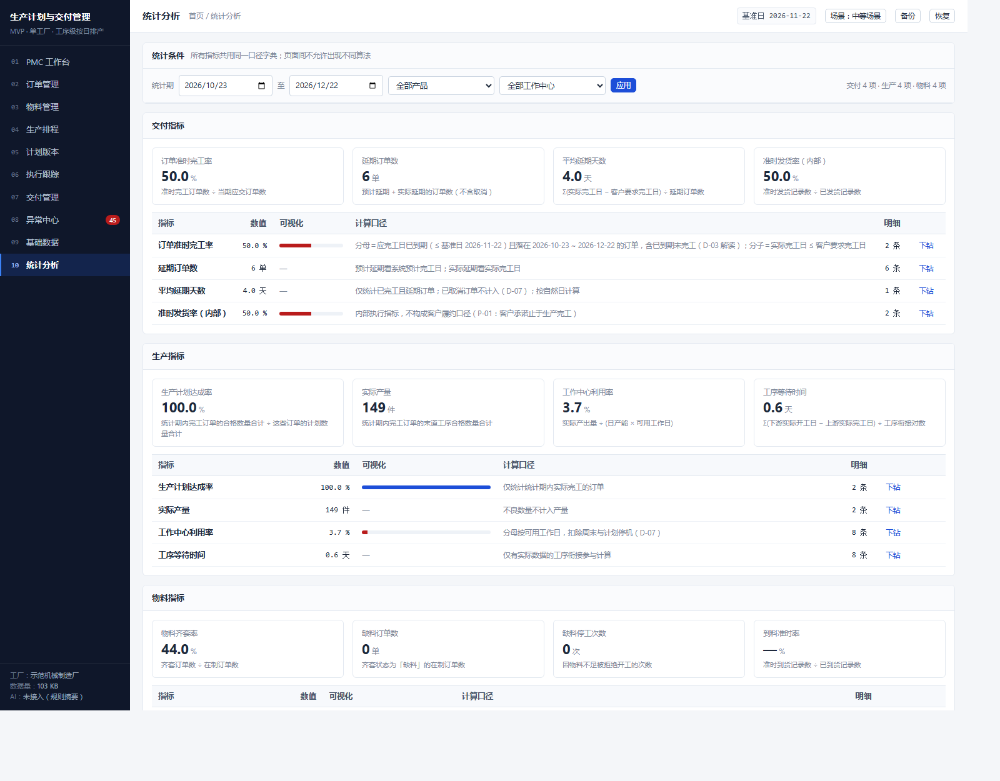

# 生产计划与交付管理 MVP

> 面向 PMC（生产计划与物料控制）的轻量级生产计划与交付管理系统：**工序级按日排产、物料齐套判定、执行数量勾稽、交付风险预警**。
> 零依赖、无构建、无框架、无 CDN —— 克隆下来起一个静态服务器就能跑。

[](https://github.com/Zoe-sofia/ppd-mvp/actions/workflows/ci.yml)
[](https://github.com/Zoe-sofia/ppd-mvp/actions/workflows/pages.yml)
[](./LICENSE)
[](./app/package.json)

**[▶ 在线演示](https://zoe-sofia.github.io/ppd-mvp/)** — 首次打开自动生成演示数据，无需登录、无需配置。


---

## 1. 它解决什么问题

中小制造企业的 PMC 通常用 Excel 排产：产能靠估、缺料靠问、进度靠催。这套 MVP 把四件事放进同一个数据模型里：

| 痛点 | 本项目的处理方式 |
|---|---|
| 排产排出来"账面不超产能、实际超工时" | 产能按**物理量**占用（件/日或工时/件），排产与校验共用同一对函数，结论必然一致 |
| 缺料到开工那天才发现 | 两级 BOM 展开 + 五态齐套判定，整单按最差项（短板原则）判定 |
| 报工数量对不上账 | 数量勾稽三闸门（物料 / 上游可流转 / 完成≤开工），所有申报写入只增不改的报工履历 |
| 交付风险说不清依据 | 12 项指标集中定义，每项都带公式、口径与可下钻明细 |

## 2. 快速开始

### 2.1 在线访问（推荐，零安装）

直接打开 **[https://zoe-sofia.github.io/ppd-mvp/](https://zoe-sofia.github.io/ppd-mvp/)** 即可使用。

这是 GitHub Pages 托管的**纯静态站点**：不需要克隆、不需要装 Node、不需要在本机起任何服务，
也不依赖任何后台进程（本机的 `python -m http.server` 只是开发时可选的自测方式）。
仓库 push 到 `main` 后由 `.github/workflows/pages.yml` 自动构建发布，站点文件即 `app/` 目录。

能脱离后台服务运行，靠的是三条约定（都已在代码里落实，不是"摆上去试试"）：

| 依赖项 | 现状 |
|---|---|
| 资源路径 | 全部相对路径（`./assets/...`），因此挂在 `/<repo>/` 子路径下也能正常加载 |
| 路由 | hash 路由（`#/dashboard`），刷新与直链不需要服务端 rewrite；未知 hash 回退工作台 |
| 接口 / 后端 | 无。没有 `fetch` / XHR / WebSocket / Service Worker，数据只在浏览器本地 |

配套文件：`app/.nojekyll`（关闭 Jekyll）、`app/404.html`（未知路径回退页）、
`app/index.html` 里的 `file://` 兜底提示（双击打开时明确告知"请通过网址访问"，而不是白屏）。
CI 的部署步骤还会校验必需文件、并**拦截 `src="/..."` 这类根路径引用** —— 那是一上线就白屏的头号原因。

> 想部署到自己的仓库或域名：把 `app/` 整个目录原样发布到目标路径即可，代码里没有写死的 origin。
> 唯一的例外是 `index.html` 的 `og:image` / `canonical` 与 `404.html` 里的在线地址，只影响分享卡片，
> 不影响功能，按需替换。

#### 在线演示的数据是每人一份，不共享

这一点容易被误解，所以单独说明：**多人打开同一个在线地址，彼此看不到对方的数据；换设备、换浏览器也看不到。**

| 场景 | 数据在哪 | 别人能看到吗 |
|---|---|---|
| A 在自己电脑的 Chrome 打开在线地址并导入 Excel | A 这台电脑这个浏览器的 `localStorage` | 看不到 |
| B 在另一台电脑打开同一个网址 | B 自己浏览器的 `localStorage`，初始为空 → 自动生成演示数据 | 看不到 A 的 |
| A 换用 Edge，或换一台机器 | 又一次全新的 `localStorage` | 看不到 |
| A 用无痕窗口 | 独立的临时 `localStorage`，关闭即丢弃 | 看不到，也不留痕 |

原因是这类站点没有后端：GitHub Pages 只托管静态文件（HTML/CSS/JS），**没有数据库、没有接口、也没有账号体系**，
浏览器出于同源策略也不允许一个站点读写另一个站点的 `localStorage`。所以「在线演示」等于一份**本机沙盒**：
随便导入、随便改、随便清空，都不会影响任何人，也不会污染仓库。

需要多人共用同一份数据时，只有两条路（都超出当前 MVP 的范围，见 §9）：

1. **手动传递整库文件**——一方「备份」导出 JSON，另一方「恢复」导入；或把 JSON 放进仓库再由对方下载导入。
   适合交接、复现问题、递交测评样本。
2. **接一个后端**——把 `core/store.js` 的读写换成接口调用（其余 `core/` 层无需改动，见 §5 分层）。
   届时才需要账号、权限与并发控制。

> 仓库里不存在任何"测试导入数据"。`app/tests/fixtures/` 下的是**自动化测试用的样本文件**（xlsx / xls / GBK-CSV），
> 部署时不会被当成数据加载，也不会写进任何用户的浏览器。

### 2.2 本地运行

```bash
git clone https://github.com/Zoe-sofia/ppd-mvp.git
cd ppd-mvp/app

# 任选一种静态服务器
python -m http.server 8099      # 或 npm start
npx serve . -l 8099             # 或 npm run serve:node
```

打开 <http://127.0.0.1:8099/>。

> **不要双击 `index.html`。** 浏览器对 `file://` 下的 ES module 有 CORS 限制，页面会白屏；必须通过 http 打开。

数据保存在浏览器 `localStorage`（键名 `ppd-mvp-v1`），刷新不丢；右上角可导入 Excel/CSV、备份/恢复 JSON、切换三套演示场景（简单 6/7 单、中等 25/27 单、复杂 80/84 单）。

**要跑自己的数据**：右上角「导入」→ 一次选中多个 Excel（`.xlsx` / `.xls`）或 CSV 文件。
系统按内容自动识别每份文件属于产品、物料、BOM、库存、销售订单行还是生产订单，逐行校验后**合并**进现有库：
主数据按编码更新、单据重复即跳过，**不清空已有数据，销售与生产订单分别导入也不会互相覆盖**。
手工录入的记录会保留。详细规则见 [`app/README.md` §5.2](./app/README.md)。

**清空/重置**：顶栏「场景：…」→「数据管理」，可切内置场景、载入整库 JSON、查看导入履历，或**清空全部数据**
（需输入「清空」确认，默认先自动导出备份）。

## 3. 功能与页面

| # | 页面 | 关键能力 |
|---|---|---|
| 01 | PMC 工作台 | 在制/待排产/生产中/缺料/产能冲突/交付风险六类计数，今日任务、中心负荷、待处理异常、关键指标 |
| 02 | 订单管理 | 销售订单 → 生产订单（一拆多、多对一）双源关联，交期与优先级维护，生产订单全列筛选与排序 |
| 03 | 物料管理 | 齐套分析五态 + 选中订单明细置顶、物料预留（确认即扣减可分配库存，可取消）、库存/到货、订单 BOM 需求树 |
| 04 | 生产排程 | 三套权重策略自动排产、甘特视图、硬约束拦截、六维筛选与排序、**当日计划查询**、约束规则说明表、逐工序调整、计划确认 |
| 05 | 计划版本 | 版本快照与对比、冻结期判定与解冻留痕 |
| 06 | 执行跟踪 | 开工/完工申报过三闸门、报工履历、停工记录、Excel 报工导入 |
| 07 | 交付管理 | 日期链、五类延期识别、发货登记（内部节点） |
| 08 | 异常中心 | 自动识别、去重、状态流转、**每条异常必带可下钻明细**、规则摘要（AI 未接入的降级态） |
| 09 | 基础数据 | 工作中心、工作日历、BOM（按产品/层级/母项筛选）、库存、工艺路线（按产品/工序筛选）维护；Excel/CSV 多文件导入与数据管理入口 |
| 10 | 统计分析 | 12 项指标按交付/生产/物料分组，指标口径可查、明细可下钻 |

<p align="center">
  
  
</p>
<p align="center">
  
</p>

## 4. 项目结构

按"模块化单体"分层：**业务规则不在页面组件里**。

```
.
├─ app/                        # 可运行的静态站点（GitHub Pages 的发布目录）
│  ├─ index.html               # 仅挂载点 + 一个 module script
│  ├─ assets/
│  │  ├─ css/app.css           # 设计系统：色板 / 表格 / 卡片 / 甘特 / 弹窗
│  │  ├─ favicon.svg           # 站点图标
│  │  └─ js/
│  │     ├─ app.js             # 外壳：路由、导航、场景切换、备份恢复、空库提示
│  │     ├─ io.js              # 导入规格与合并语义：场景识别 / 逐行校验 / 去重 / 批量编排
│  │     ├─ core/              # 规则与算法层 + 数据持久层（可脱离 DOM 测试）
│  │     │  ├─ constants.js    #   口径单一来源：状态枚举、不良原因、约束清单、红线
│  │     │  ├─ calendar.js     #   工作日历：可用工作日、不可生产日、顺延
│  │     │  ├─ rules.js        #   BOM 两级展开、齐套判定、可用库存、能力换算
│  │     │  ├─ constraints.js  #   HC-01~05 / SC-01~05 校验（违规带四要素）
│  │     │  ├─ scheduler.js    #   九因素→三桶加权评分 + 优先级贪心按日占用产能
│  │     │  ├─ execution.js    #   数量勾稽三闸门 + 报工履历
│  │     │  ├─ metrics.js      #   12 项指标口径字典（公式 / 口径 / 明细）
│  │     │  ├─ exceptions.js   #   异常识别、去重、状态流转
│  │     │  ├─ freeze.js       #   冻结期判定与解冻留痕
│  │     │  ├─ ai.js           #   规则摘要（AI 未接入时的降级实现）
│  │     │  ├─ store.js        #   localStorage 单库读写、备份/恢复、清空、就地替换
│  │     │  ├─ sheet.js        #   CSV（编码/分隔符嗅探）/ XLSX（zip+XML）/ XLS（OLE2+BIFF8）解析
│  │     │  ├─ dataset.js      #   整库 JSON 导入：校验 / 归一 / 版本重连 / 示例模板
│  │     │  └─ seed.js         #   三套演示数据（固定种子，结果可复现）
│  │     └─ ui/
│  │        ├─ dom.js          #   表格 / 徽标 / 进度条 / 弹窗 / 提示
│  │        ├─ import-center.js#   批量导入（多文件/场景识别）与数据管理（场景/整库/履历/清空）
│  │        └─ pages/          #   10 个页面，只取数与渲染，不含业务规则
│  ├─ tests/verify.mjs         # 31 项算法校验（数量守恒 / 可复现 / 约束拦截）
│  ├─ tests/io.test.mjs        # 50 项导入导出校验（CSV 解析 / 逐行校验 / 覆盖语义 / 日期容错）
│  ├─ tests/dataset.test.mjs   # 42 项整库 JSON 校验（信封 / 字段定位 / 版本重连）
│  ├─ tests/import-files.test.mjs # 63 项 Excel/CSV 批量导入校验（三格式 / 多批次 / 互不覆盖）
│  ├─ tests/rules.test.mjs    # 34 项业务规则回归（齐套累计口径 / 半成品展开 / orderLinks / 异常明细）
│  ├─ tests/fixtures/          # 测试样本（xlsx / xls / GBK-CSV）与生成脚本
│  ├─ tests/check-syntax.mjs   # 语法门禁
│  └─ package.json             # 无依赖；仅用于 ESM 与脚本入口
├─ docs/                       # 方案文档与界面截图
└─ .github/workflows/          # CI 与 GitHub Pages 部署
```

`core/` 不引用任何 DOM API，因此可以直接在 Node 里 `import` 做校验 —— 这是测试能跑起来的前提。

## 5. 几个关键实现决策

- **硬约束先行**：HC-01 工序顺序、HC-02 工作中心能力、HC-03 不可生产日期、HC-04 日产能超限、HC-05 下游数量超上游。存在硬约束时"确认计划"按钮被禁用；软约束只提示不拦截。每条约束都写明**判定口径 / 命中影响 / 怎么改**，并统计当前命中数（排程页可展开查看）。
- **产能按物理量占用**：同一工作中心常承接标准工时不同的多道工序，若一律按"件"占用，会排出"账面不超产能、实际超工时"的计划。排产与 HC-04 校验共用 `capacityPoolOf` / `capacityDemandOf`，两处结论始终一致。
- **约束判定与任务顺序无关**：HC-04 按 (工作中心, 日期) 汇总后只报一条，结果不受任务数组顺序影响（有对应测试）。
- **可复现**：排产不含随机数与当前时间，同一输入两次排产结果逐字节一致；演示数据用固定种子生成。
- **不承诺全局最优**：九因素归入交付/物料/产能三桶加权后按优先级贪心排，界面已明示这一点。
- **分母为 0 显示 `—` 而不是 `0.0%`**：`0.0%` 会被读成"实际为 0"，真相是"没有样本"。
- **到货"合计够"不等于"哪天够"**：齐套判定按日期逐日累计已确认到货（库存 + 预计到货日 ≤ d 的到货），
  取**首次达需日**，再对整单所有缺料物料取**最晚**那个作为整单齐套日 —— 而不是看确认到货合计，
  也不是看首批到货日。前者会把"两批各 40、需求 70"误判为已齐套，后者会漏掉"首批够、第二批不够"。
  任一缺料物料永远不够时整单齐套日返回空（不可知），不编造日期。
- **半成品有两种口径，必须分清**：`explodeBom()` 用于**算需求**——半成品若有下级 BOM 就只展开下级材料，
  半成品自身不计需求（自制件不该被"采购"）；但半成品**仍作为库存标的出现在库存/到货页**，
  且在"订单 BOM 物料需求明细"里以树形保留半成品行 + 下级材料缩进，让人看清"这批料是为哪个半成品备的"。
  两个函数（`explodeBom` / `explodeBomTree`）需求数量口径一致，只是一个平铺、一个带层级。
- **一拆多要能双向查**：销售行 → 生产订单既有 `productionOrders.salesOrderLineId`（用于回查交期），
  也有 `orderLinks` 关联表（一张销售行可挂多张生产订单，且能带分配数量）。导入生产订单时两者同时写入，
  否则销售订单页的"生产订单"列只能显示"建立生产订单"——明明已经建了。
- **排序不污染数据层**：表格排序是"看"的行为，`table()` 只负责渲染（输出可点的表头 + 箭头状态），
  排序由 `sortRows()` 在页面层完成；筛选同理，排程页的筛选只影响展示，约束校验始终跑全量任务。

## 6. 测试

```bash
cd app
npm test          # 31 算法 + 50 导入导出 + 42 整库 JSON + 63 Excel/CSV 批量导入 + 34 业务规则 = 220 项，全部通过
npm run check     # 34 个 ES Module 的语法门禁
```

**算法侧**（`tests/verify.mjs`，31 项）：三套场景数据完整性、数量守恒（逐单逐工序）、排产可复现（三次一致）、
三套策略输出可区分、HC-01~05 逐条构造违规必须被识别、合法计划无硬约束、**约束判定与任务顺序无关**、
三闸门拒绝超量开工/完工、12 项指标无 NaN、异常覆盖 ≥3 类且去重生效。

**导入导出侧**（`tests/io.test.mjs`，50 项）：模板表头与规格一致、CSV 边界（BOM / CRLF / 引号内逗号 /
内嵌换行 / 空行）、逐行校验的行号与字段定位（必填 / 枚举 / 数字 / 日期 / 关联不存在 / 文件内重复）、
主数据按编码覆盖而单据重复即拒绝、导出转义、XLSX 非法输入的失败姿态、日期容错（斜杠日期与 Excel 序列号）。

**数据集导入侧**（`tests/dataset.test.mjs`，42 项）：四种顶层信封、必填集合与形状校验、字段级错误定位
（数量 / 枚举 / 日期含非法日历日 / 编号重复 / 关联不存在）、编码→id 解析、**脱链任务重挂工作版本**
（回归：修复前导入后计划页可见 0 条）、缺版本时自动建版本、失效 `activeVersionId` 修正、
与备份格式互导、导入后可直接排产且 12 项指标无 NaN。

**Excel/CSV 批量导入侧**（`tests/import-files.test.mjs`，63 项）：真实 xlsx / xls / GBK-CSV 文件解析
（标题行、日期序列号、多工作表、共享字符串跨 `CONTINUE` 的 601 行大表）、表头别名与场景自动识别、
多文件按依赖顺序处理、错误隔离（坏文件不影响好文件）、**销售与生产分别导入互不覆盖**、
重复导入幂等、手工录入保留、BOM/库存按自然键去重、清空后不重建演示数据且可重新导入；
另有存储变体兼容用例（命名空间前缀、单引号属性、无 `sharedStrings`、富文本 `runs`、缺 `r` 属性、
绝对路径 target、write-only 产物、合并单元格、表头带单位括号、表头靠后、信息量不足不硬猜、空表）。

CI 在每次 push / PR 上跑上述五个测试文件（[`.github/workflows/ci.yml`](./.github/workflows/ci.yml)）。

**业务规则回归侧**（`tests/rules.test.mjs`，34 项）：这组用例专盯"算对了没有"，用 TA-PO-001~008 八张订单
逐条钉住齐套口径 ——

| 订单 | 构造 | 期望 | 钉住的是什么 |
|---|---|---|---|
| TA-PO-001 | 到货 40@+1、40@+5，需求 70，开工 +3 | 到货风险，达需日 = +5 | 只看首批（+1 早于开工）或只看合计（80≥70）都会误判 |
| TA-PO-002 | 库存 56，需求 56 | 齐套，达需日为空 | 库存即够时不该编造到货日期 |
| TA-PO-003 | 库存 8 + 到货 20@+2，需求 28，开工 +4 | 预计齐套，达需日 = +2 | 库存与到货要合并累计 |
| TA-PO-004 | 到货 24@+10，开工 +2 | 到货风险，达需日 = +10 | 单批到货晚于开工 |
| TA-PO-005 | 库存 30，需求 30 | 齐套 | 恰好相等算齐套（gap = 0 不进入缺料） |
| TA-PO-006 | 无库存无到货 | 缺料，整单齐套日为空 | 永远不够时返回空，不编日期 |
| TA-PO-007 | 库存 10 + 到货 16@+3，需求 26，开工 +5 | 预计齐套 | 分批累计仍早于开工 |
| TA-PO-008 | 到货 16@+2、16@+7，需求 32，开工 +4 | 到货风险，达需日 = +7 | 首批够、第二批才达需 |

另外还覆盖：**整单齐套日取缺料物料中最晚的那个**（给 TA-PO-001 再加一个 +9 达需的物料，整单齐套日必须从 +5 变成 +9）、
`materialReadyDate()` 与 `kittingOf()` 结论同步、**未排产（`planStart` 空）不误判为到货风险**、
**任何异常都带非空明细**、未排产订单不产生"预计到货延期"异常、`explodeBom` 不把有下级 BOM 的半成品计入需求
但半成品库存仍可见、`explodeBomTree` 保留半成品行并给出缩进/所属母项/换算后的需求量、
导入生产订单同时写 `orderLinks`（且重复导入被拒绝、不重复建关联）。

> 这组用例本身也踩过一次坑，值得记下来：最初把八张订单挂在同一个产品下，而该产品的 BOM 有 8 个物料，
> 于是每张订单都"缺 7 个物料"，16 项断言全红。**是夹具错了，不是规则错了** —— 改成"一单一个产品 + 一对一 BOM"
> 后 34 项全绿。构造测试数据时，"订单实际需要什么"必须显式、可控，否则会测出一个假失败。

**未自动化的部分**：页面渲染与弹窗链路（开工 / 完工 / 改派 / 导入 / 版本对比）目前靠手工验收，欢迎补 E2E。
已手工做过的浏览器回归：三套场景 10 个路由无渲染报错、真实文件选择器完成多文件导入与重复导入、
清空确认链路；以及**子路径部署回归**（`/ppd-mvp/` 下 22 项检查全通过、无 4xx 资源、hash 直链可用）。
导入链路另做过一次无头 Chromium 手工回归：真实文件选择器完成 3 文件导入并写库、重复导入条数不变、
清空确认与空库页面渲染均正常。

**本轮交互改动也过了一遍无头浏览器 E2E（31 项断言）**：齐套明细置顶与未筛选为空、表头排序三态切换、
物料预留确认后扣减并提示、取消确认后释放库存、BOM 按产品/层级/母项筛选、工艺路线按产品/工序筛选、
排程六维筛选 + 当日计划查询 + 约束说明表、异常中心无空明细，全程无未捕获异常。

## 7. 运行环境与依赖

- **依赖：0 个。** `package.json` 里没有 `dependencies`，也不加载任何 CDN 资源，断网可用。
- **Node 仅用于测试**（≥18）；运行系统本身不需要 Node。
- **浏览器**：Chrome / Edge 90+；Firefox 113+；Safari 16.4+。
  `.xlsx` 导入依赖原生 `DecompressionStream`；`.xls` 与 CSV（含 GBK）不依赖它。

## 8. 环境变量与数据

**本项目不需要任何环境变量或密钥。** 没有后端、没有外部请求、没有埋点；所有数据只存在当前浏览器的 `localStorage` 里，不会上传到任何地方。

> **因此数据是"每设备每浏览器一份"，不共享。** 在线演示地址、本机 http 地址、无痕窗口、不同浏览器，
> 各自是一个独立的库；A 导入的数据 B 看不到，反之亦然（原因与替代方案见 [§2.1](#在线演示的数据是每人一份不共享)）。
> 这也是"测试导入数据"不会外泄、不会污染他人演示的原因。

- 数据键名：`ppd-mvp-v1`；数据内含 `SEED_REV` 版本号，旧版演示数据会提示一键重建。
- 数据入口共四类：第 1 类是**合并**，第 2~4 类是**整库替换**：
  1. **Excel/CSV 批量导入**（顶栏「导入」或基础数据页「导入文件」）——多文件、自动识别场景、合并进现有库，
     主数据按编码更新（保留 id）、单据重复即跳过；**不清空、不跨场景覆盖**，手工录入的数据保留；
  2. **内置场景**（顶栏「场景：…」）——重建整套演示数据（替换）；
  3. **整库 JSON**（「场景」→「数据管理」）——载入测试数据集或备份（替换）；
  4. **恢复备份**（顶栏「恢复」）——载入本系统导出的全量备份（替换）。
  2~4 共用 `core/dataset.js` 的校验：只要包含 `productionOrders` 即可，缺计划版本会自建工作版本并重连任务，
  避免"导入成功但计划页空白"。
- 清空：顶栏「场景：…」→「数据管理」→「清空全部数据」，需输入「清空」确认，默认先自动导出备份；
  清空后不会自动重建演示数据，顶栏会出现"数据库为空"提示条。
- 迁移：右上角「备份」导出 JSON 全量文件，「恢复」导入并二次确认。

## 9. 明确未做的部分

与方案 §10 一致，避免误用：

- 报废 / 返工 / 返修流程；多工厂与多组织。
- 与 ERP / MES / WMS 的系统集成：当前只有文件级导入导出（Excel/CSV/JSON），没有 API、账号打通与实时同步；字段映射集中在 `io.js` 的 `IMPORT_SPECS`，将来接入接口只需在 `core/` 增加 adapter。
- 权限体系（单用户本机、无登录）、审批流、消息通知。
- 真正的最优化求解（当前是确定性启发式）。
- AI 能力：当前为**降级态**——异常详情的"事实/推测/建议"由确定性规则模板生成，界面明确标注 `AI 未接入`，且只读不改数据。接入真实模型时只需替换 `core/ai.js`。
- 甘特图拖拽（当前通过"调整该工序"弹窗改期/改中心，改后立即重算硬约束）。

## 10. 文档

| 文档 | 内容 |
|---|---|
| [`app/README.md`](./app/README.md) | **实现说明**：分层、规则如何落地、两处口径解读、验证清单 |
| [`docs/mvp-execution-plan-v1.0.md`](./docs/mvp-execution-plan-v1.0.md) | 最终执行方案：16 项决策台账、31 项补充、阶段门禁与验收红线 |
| [`docs/mvp-execution-plan-review-v1.0.md`](./docs/mvp-execution-plan-review-v1.0.md) | 评审稿（已被上者取代，保留用于追溯） |
| [`docs/mvp-acceptance-walkthrough-v1.0.md`](./docs/mvp-acceptance-walkthrough-v1.0.md) | **测评操作手册**：前置条件、账号与数据归属、逐页操作、导入规格、13 组检查清单、异常处理与风险登记 |
| [`CHANGELOG.md`](./CHANGELOG.md) | 版本记录 |
| [`CONTRIBUTING.md`](./CONTRIBUTING.md) | 开发约定、分层纪律、提交规范 |

## 11. 参与贡献

欢迎 Issue 与 PR。动手前请先看 [`CONTRIBUTING.md`](./CONTRIBUTING.md) —— 最重要的一条：**业务规则写进 `core/`，不要在 `ui/pages/` 里做计算**。

## 12. 许可证

[MIT](./LICENSE) © 2026 Zoe Lin

---

## English Summary

A dependency-free, build-free production planning & delivery management MVP for small and mid-sized manufacturers, written in vanilla ES modules.

It keeps planning, materials, execution and delivery in one data model: **hard-constraint-first daily scheduling** at the operation level (capacity consumed in physical units, so the plan and the validator can never disagree), **two-level BOM kitting** with a worst-case rule, **quantity reconciliation gates** that block over-reporting, and a **12-metric dictionary** where every number carries its formula and drill-down.

No backend, no CDN, no `node_modules`: clone it, serve the `app/` folder, and it runs. Data lives in `localStorage`. It is also published as a pure static site on GitHub Pages — relative asset paths, hash routing and zero network calls, so the online demo needs no server process of its own.

Your own data can be imported from **Excel (`.xlsx` / `.xls`) or CSV** — several files at once, scenarios detected from sheet names/headers, merged rather than replacing: master data is updated by code (ids preserved), documents are skipped when duplicated, so sales and production orders never overwrite each other and manual entries survive. A full-dataset JSON import and a guarded "clear all data" action are available under 场景 → 数据管理. Note that data is **per browser, per device** — there is no backend, so two people opening the same demo URL never see each other's data (each browser has its own `localStorage`). 220 automated checks (31 algorithmic: reproducibility, quantity conservation, constraint detection, zero NaN metrics; 50 on import/export: CSV edge cases, row-level validation, date tolerance; 42 on JSON dataset import: envelopes, field-level errors, version relinking; 63 on Excel/CSV batch import: real xlsx/xls/GBK fixtures, xlsx storage variants, header/scenario detection, multi-batch idempotency, cross-scenario isolation, clear-all; 34 on business-rule regressions: day-by-day inbound accumulation for kitting readiness, worst-case order-level ready date, semi-finished BOM expansion, sales-line↔production-order linking, non-empty exception details) run on every push via GitHub Actions.

Licensed under MIT.
