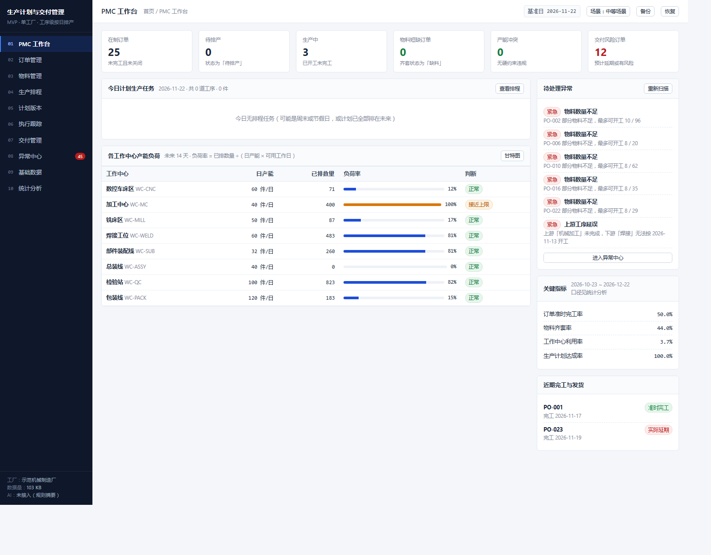
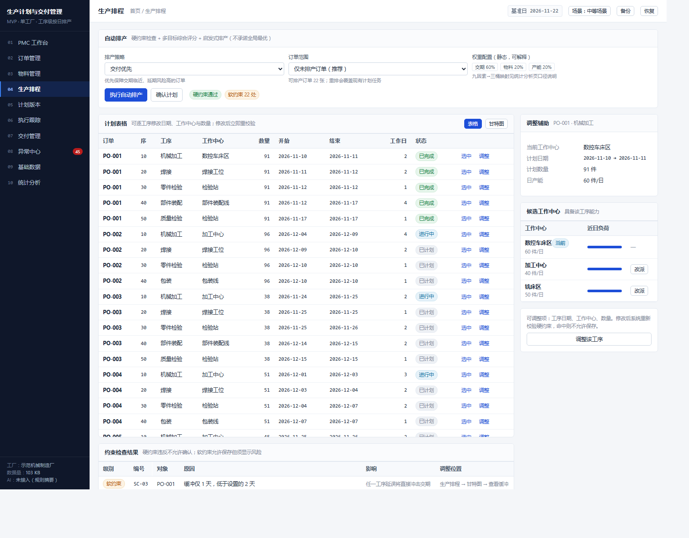
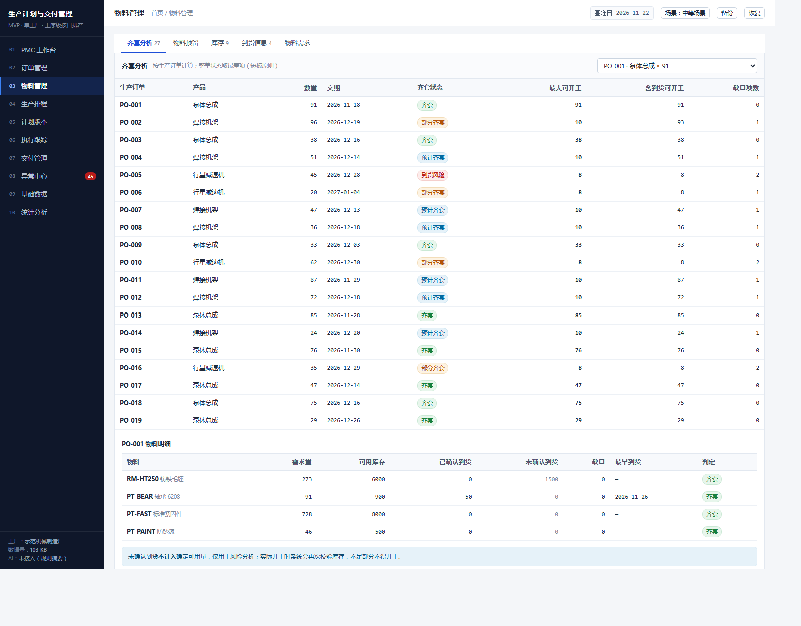

# 生产计划与交付管理 MVP

> 面向 PMC（生产计划与物料控制）的轻量级生产计划与交付管理系统：**工序级按日排产、物料齐套判定、执行数量勾稽、交付风险预警**。
> 零依赖、无构建、无框架、无 CDN —— 克隆下来起一个静态服务器就能跑。

[](https://github.com/Zoe-sofia/ppd-mvp/actions/workflows/ci.yml)
[](https://github.com/Zoe-sofia/ppd-mvp/actions/workflows/pages.yml)
[](./LICENSE)
[](./app/package.json)

**[▶ 在线演示](https://zoe-sofia.github.io/ppd-mvp/)** — 首次打开自动生成演示数据，无需登录、无需配置。



---

## 1. 它解决什么问题

中小制造企业的 PMC 通常用 Excel 排产：产能靠估、缺料靠问、进度靠催。这套 MVP 把四件事放进同一个数据模型里：

| 痛点 | 本项目的处理方式 |
|---|---|
| 排产排出来"账面不超产能、实际超工时" | 产能按**物理量**占用（件/日或工时/件），排产与校验共用同一对函数，结论必然一致 |
| 缺料到开工那天才发现 | 两级 BOM 展开 + 五态齐套判定，整单按最差项（短板原则）判定 |
| 报工数量对不上账 | 数量勾稽三闸门（物料 / 上游可流转 / 完成≤开工），所有申报写入只增不改的报工履历 |
| 交付风险说不清依据 | 12 项指标集中定义，每项都带公式、口径与可下钻明细 |

## 2. 快速开始

```bash
git clone https://github.com/Zoe-sofia/ppd-mvp.git
cd ppd-mvp/app

# 任选一种静态服务器
python -m http.server 8099      # 或 npm start
npx serve . -l 8099             # 或 npm run serve:node
```

打开 <http://127.0.0.1:8099/>。

> **不要双击 `index.html`。** 浏览器对 `file://` 下的 ES module 有 CORS 限制，页面会白屏；必须通过 http 打开。

数据保存在浏览器 `localStorage`（键名 `ppd-mvp-v1`），刷新不丢；右上角可备份/恢复 JSON、切换三套演示场景（简单 6/7 单、中等 25/27 单、复杂 80/84 单）。

**要跑自己的测试数据**：右上角「场景：…」→「导入外部测试数据」→ 选择 JSON（可先「下载示例数据集」）。
只要包含 `productionOrders` 即可，其余集合可缺省；缺计划版本/任务版本关联时会自动修复，
不会出现"导入成功但计划页空白"。格式与行为见 [`app/README.md` §5.2](./app/README.md)。

## 3. 功能与页面

| # | 页面 | 关键能力 |
|---|---|---|
| 01 | PMC 工作台 | 在制/待排产/生产中/缺料/产能冲突/交付风险六类计数，今日任务、中心负荷、待处理异常、关键指标 |
| 02 | 订单管理 | 销售订单 → 生产订单（一拆多、多对一），交期与优先级维护 |
| 03 | 物料管理 | 齐套分析五态、物料预留、到货信息、单订单物料明细展开 |
| 04 | 生产排程 | 三套权重策略自动排产、甘特视图、硬约束拦截、逐工序调整、计划确认 |
| 05 | 计划版本 | 版本快照与对比、冻结期判定与解冻留痕 |
| 06 | 执行跟踪 | 开工/完工申报过三闸门、报工履历、停工记录、批量导入 |
| 07 | 交付管理 | 日期链、五类延期识别、发货登记（内部节点） |
| 08 | 异常中心 | 自动识别、去重、状态流转、规则摘要（AI 未接入的降级态） |
| 09 | 基础数据 | 工作中心、工作日历、BOM、库存、工艺路线维护与 CSV/XLSX 导入 |
| 10 | 统计分析 | 12 项指标按交付/生产/物料分组，指标口径可查、明细可下钻 |

<p align="center">
  
  
</p>
<p align="center">
  
</p>

## 4. 项目结构

按"模块化单体"分层：**业务规则不在页面组件里**。

```
.
├─ app/                        # 可运行的静态站点（GitHub Pages 的发布目录）
│  ├─ index.html               # 仅挂载点 + 一个 module script
│  ├─ assets/
│  │  ├─ css/app.css           # 设计系统：色板 / 表格 / 卡片 / 甘特 / 弹窗
│  │  ├─ favicon.svg           # 站点图标
│  │  └─ js/
│  │     ├─ app.js             # 外壳：路由、导航、场景切换、外部数据集导入、备份恢复
│  │     ├─ io.js              # 导入导出：CSV / XLSX 解析与逐行校验
│  │     ├─ core/              # 规则与算法层 + 数据持久层（可脱离 DOM 测试）
│  │     │  ├─ constants.js    #   口径单一来源：状态枚举、不良原因、约束清单、红线
│  │     │  ├─ calendar.js     #   工作日历：可用工作日、不可生产日、顺延
│  │     │  ├─ rules.js        #   BOM 两级展开、齐套判定、可用库存、能力换算
│  │     │  ├─ constraints.js  #   HC-01~05 / SC-01~05 校验（违规带四要素）
│  │     │  ├─ scheduler.js    #   九因素→三桶加权评分 + 优先级贪心按日占用产能
│  │     │  ├─ execution.js    #   数量勾稽三闸门 + 报工履历
│  │     │  ├─ metrics.js      #   12 项指标口径字典（公式 / 口径 / 明细）
│  │     │  ├─ exceptions.js   #   异常识别、去重、状态流转
│  │     │  ├─ freeze.js       #   冻结期判定与解冻留痕
│  │     │  ├─ ai.js           #   规则摘要（AI 未接入时的降级实现）
│  │     │  ├─ store.js        #   localStorage 单库读写、备份/恢复
│  │     │  ├─ dataset.js      #   外部测试数据集导入：校验 / 归一 / 版本重连 / 示例模板
│  │     │  └─ seed.js         #   三套演示数据（固定种子，结果可复现）
│  │     └─ ui/
│  │        ├─ dom.js          #   表格 / 徽标 / 进度条 / 弹窗 / 提示
│  │        └─ pages/          #   10 个页面，只取数与渲染，不含业务规则
│  ├─ tests/verify.mjs         # 31 项算法校验（数量守恒 / 可复现 / 约束拦截）
│  ├─ tests/io.test.mjs        # 49 项导入导出校验（CSV 解析 / 逐行校验 / 覆盖语义）
│  ├─ tests/dataset.test.mjs   # 42 项数据集导入校验（信封 / 字段定位 / 版本重连）
│  ├─ tests/check-syntax.mjs   # 语法门禁
│  └─ package.json             # 无依赖；仅用于 ESM 与脚本入口
├─ docs/                       # 方案文档与界面截图
└─ .github/workflows/          # CI 与 GitHub Pages 部署
```

`core/` 不引用任何 DOM API，因此可以直接在 Node 里 `import` 做校验 —— 这是测试能跑起来的前提。

## 5. 几个关键实现决策

- **硬约束先行**：HC-01 工序顺序、HC-02 工作中心能力、HC-03 不可生产日期、HC-04 日产能超限、HC-05 下游数量超上游。存在硬约束时"确认计划"按钮被禁用；软约束只提示不拦截。
- **产能按物理量占用**：同一工作中心常承接标准工时不同的多道工序，若一律按"件"占用，会排出"账面不超产能、实际超工时"的计划。排产与 HC-04 校验共用 `capacityPoolOf` / `capacityDemandOf`，两处结论始终一致。
- **约束判定与任务顺序无关**：HC-04 按 (工作中心, 日期) 汇总后只报一条，结果不受任务数组顺序影响（有对应测试）。
- **可复现**：排产不含随机数与当前时间，同一输入两次排产结果逐字节一致；演示数据用固定种子生成。
- **不承诺全局最优**：九因素归入交付/物料/产能三桶加权后按优先级贪心排，界面已明示这一点。
- **分母为 0 显示 `—` 而不是 `0.0%`**：`0.0%` 会被读成"实际为 0"，真相是"没有样本"。

## 6. 测试

```bash
cd app
npm test          # 31 项算法 + 49 项导入导出 + 42 项数据集导入，全部通过
npm run check     # 30 个 ES Module 的语法门禁
```

**算法侧**（`tests/verify.mjs`，31 项）：三套场景数据完整性、数量守恒（逐单逐工序）、排产可复现（三次一致）、
三套策略输出可区分、HC-01~05 逐条构造违规必须被识别、合法计划无硬约束、**约束判定与任务顺序无关**、
三闸门拒绝超量开工/完工、12 项指标无 NaN、异常覆盖 ≥3 类且去重生效。

**导入导出侧**（`tests/io.test.mjs`，49 项）：模板表头与规格一致、CSV 边界（BOM / CRLF / 引号内逗号 /
内嵌换行 / 空行）、逐行校验的行号与字段定位（必填 / 枚举 / 数字 / 日期 / 关联不存在 / 文件内重复）、
主数据按编码覆盖而单据重复即拒绝、导出转义、XLSX 非法输入的失败姿态。

**数据集导入侧**（`tests/dataset.test.mjs`，42 项）：四种顶层信封、必填集合与形状校验、字段级错误定位
（数量 / 枚举 / 日期含非法日历日 / 编号重复 / 关联不存在）、编码→id 解析、**脱链任务重挂工作版本**
（回归：修复前导入后计划页可见 0 条）、缺版本时自动建版本、失效 `activeVersionId` 修正、
与备份格式互导、导入后可直接排产且 12 项指标无 NaN。

CI 在每次 push / PR 上跑上述三项（[`.github/workflows/ci.yml`](./.github/workflows/ci.yml)）。

**未自动化的部分**：页面渲染与弹窗链路（开工 / 完工 / 改派 / 导入 / 版本对比）目前靠手工验收，欢迎补 E2E；
`parseXlsx` 的正向路径依赖 `DOMParser`，Node 环境只能覆盖其错误路径。

## 7. 运行环境与依赖

- **依赖：0 个。** `package.json` 里没有 `dependencies`，也不加载任何 CDN 资源，断网可用。
- **Node 仅用于测试**（≥18）；运行系统本身不需要 Node。
- **浏览器**：Chrome / Edge 90+；Firefox 113+；Safari 16.4+。
  XLSX 导入依赖 `DecompressionStream`，不支持的浏览器会明确提示"改用 CSV 模板"并保留 CSV 通路。

## 8. 环境变量与数据

**本项目不需要任何环境变量或密钥。** 没有后端、没有外部请求、没有埋点；所有数据只存在当前浏览器的 `localStorage` 里，不会上传到任何地方。

- 数据键名：`ppd-mvp-v1`；数据内含 `SEED_REV` 版本号，旧版演示数据会提示一键重建。
- 数据入口共三类，互不覆盖：
  1. **内置场景**（顶栏「场景：…」→ 三套演示数据）——重建整套内置数据；
  2. **外部测试数据集**（同一弹窗下半部分 → 选择 JSON）——导入自己的订单与主数据，校验通过才载入；
  3. **恢复备份**（顶栏「恢复」）——载入本系统导出的全量备份。
  后两者共用同一套校验（`core/dataset.js`），外部数据只要包含 `productionOrders` 即可，
  缺少计划版本会自建工作版本并重连任务，避免"导入成功但计划页空白"。
- 迁移/清空：右上角「备份」导出 JSON 全量文件，「恢复」导入并二次确认。

## 9. 明确未做的部分

与方案 §10 一致，避免误用：

- 报废 / 返工 / 返修流程；多工厂与多组织；与 ERP / MES 的系统集成。
- 权限体系（单用户本机、无登录）、审批流、消息通知。
- 真正的最优化求解（当前是确定性启发式）。
- AI 能力：当前为**降级态**——异常详情的"事实/推测/建议"由确定性规则模板生成，界面明确标注 `AI 未接入`，且只读不改数据。接入真实模型时只需替换 `core/ai.js`。
- 甘特图拖拽（当前通过"调整该工序"弹窗改期/改中心，改后立即重算硬约束）。

## 10. 文档

| 文档 | 内容 |
|---|---|
| [`app/README.md`](./app/README.md) | **实现说明**：分层、规则如何落地、两处口径解读、验证清单 |
| [`docs/mvp-execution-plan-v1.0.md`](./docs/mvp-execution-plan-v1.0.md) | 最终执行方案：16 项决策台账、31 项补充、阶段门禁与验收红线 |
| [`docs/mvp-execution-plan-review-v1.0.md`](./docs/mvp-execution-plan-review-v1.0.md) | 评审稿（已被上者取代，保留用于追溯） |
| [`docs/mvp-acceptance-walkthrough-v1.0.md`](./docs/mvp-acceptance-walkthrough-v1.0.md) | **测评操作手册**：前置条件、账号与数据归属、逐页操作、导入规格、13 组检查清单、异常处理与风险登记 |
| [`CHANGELOG.md`](./CHANGELOG.md) | 版本记录 |
| [`CONTRIBUTING.md`](./CONTRIBUTING.md) | 开发约定、分层纪律、提交规范 |

## 11. 参与贡献

欢迎 Issue 与 PR。动手前请先看 [`CONTRIBUTING.md`](./CONTRIBUTING.md) —— 最重要的一条：**业务规则写进 `core/`，不要在 `ui/pages/` 里做计算**。

## 12. 许可证

[MIT](./LICENSE) © 2026 Zoe Lin

---

## English Summary

A dependency-free, build-free production planning & delivery management MVP for small and mid-sized manufacturers, written in vanilla ES modules.

It keeps planning, materials, execution and delivery in one data model: **hard-constraint-first daily scheduling** at the operation level (capacity consumed in physical units, so the plan and the validator can never disagree), **two-level BOM kitting** with a worst-case rule, **quantity reconciliation gates** that block over-reporting, and a **12-metric dictionary** where every number carries its formula and drill-down.

No backend, no CDN, no `node_modules`: clone it, serve the `app/` folder, and it runs. Data lives in `localStorage`, and your own dataset can be loaded as JSON (top bar → 场景 → 导入外部测试数据). 122 automated checks (31 algorithmic: reproducibility, quantity conservation, constraint detection, zero NaN metrics; 49 on import/export: CSV edge cases, row-level validation, overwrite-vs-reject semantics; 42 on dataset import: envelopes, field-level errors, version relinking) run on every push via GitHub Actions.

Licensed under MIT.
